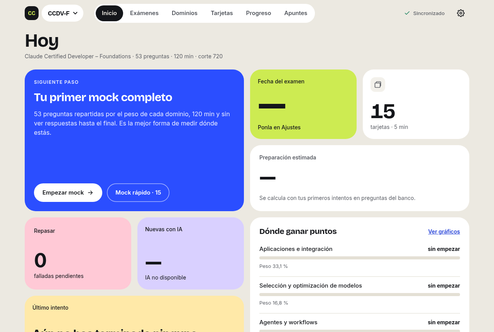
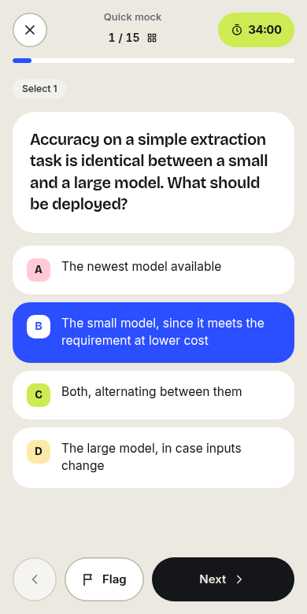
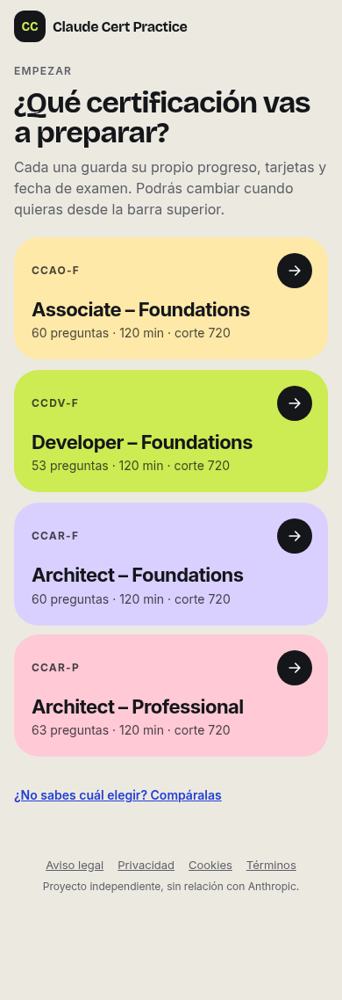
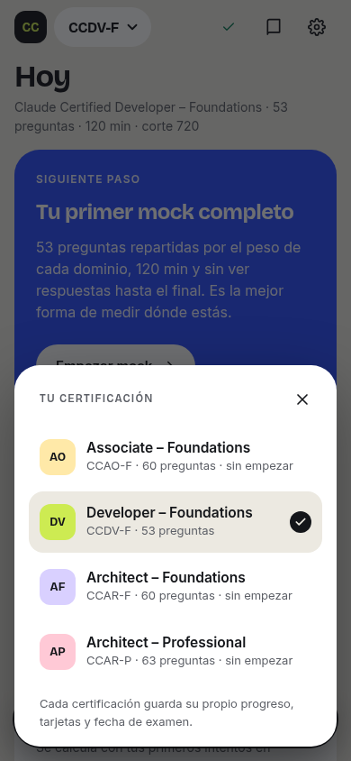
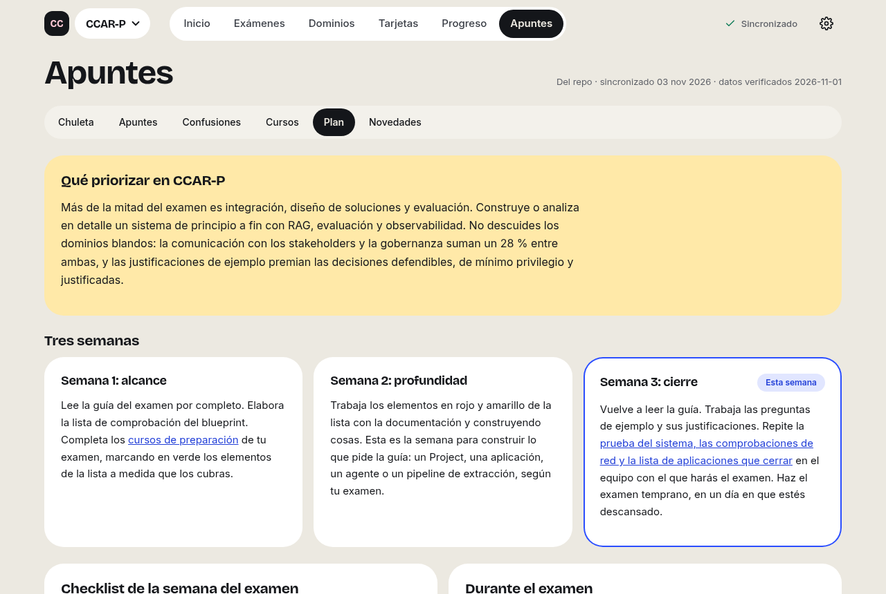

# Claude Cert Practice

**App gratuita y de código abierto para preparar los cuatro exámenes de certificación de Claude: _Associate – Foundations_ (CCAO-F), _Developer – Foundations_ (CCDV-F), _Architect – Foundations_ (CCAR-F) y _Architect – Professional_ (CCAR-P).** Eliges una al registrarte y cambias cuando quieras desde la barra superior; cada una guarda su propio progreso, tarjetas y fecha de examen. Simulacros cronometrados, drills por dominio, flashcards con repetición espaciada, tutor IA y gráficos de dónde pierdes puntos, en español e inglés y sincronizada entre tus dispositivos.

**Pruébala:** https://exam.jarsss8.es · **English:** [README.md](README.md)

> Proyecto comunitario independiente. No está creado, patrocinado ni respaldado por Anthropic. Aprobar un simulacro aquí no garantiza aprobar el examen real.

<p>
  
  
</p>
<p>
  
  
  
</p>

## Qué hace

| | |
| --- | --- |
| **Simulacros** | Mock completo con la longitud real (60, 53, 60 o 63 preguntas, 120 minutos) repartido como cada temario, mock rápido de 15 al ritmo real, los tres mocks del repo y los ejemplos de la guía oficial. Siempre en inglés, como el examen. |
| **Drills por dominio** | 10 preguntas de un dominio con corrección y explicación al momento, priorizando lo que no has visto. |
| **Preparación estimada** | Un rango de 100 a 1000 calculado solo con tus *primeros* intentos, reponderado por dominio, con el corte en 720. |
| **Gráficos** | Dónde fallas más (por puntos perdidos), evolución por dominio, preguntas que más fallas e historial de mocks. |
| **Flashcards** | Repetición espaciada FSRS; las preguntas que fallas entran solas en el mazo. |
| **Guía de estudio** | En Apuntes: las parejas de conceptos que el examen obliga a distinguir, los cursos (y la ruta oficial de preparación) de tu certificación con los vídeos de Anthropic, y un plan de tres semanas que marca en cuál estás según la fecha de examen, con la checklist de la semana del examen. |
| **Tutor IA** *(opcional)* | Pregúntale por qué una opción está mal. Solo habla de la pregunta que tienes delante. |
| **Preguntas IA** *(opcional)* | Genera preguntas nuevas basadas en los apuntes; un segundo modelo las comprueba antes de guardarlas. |
| **Dos idiomas** | Interfaz, apuntes, flashcards, drills y tutor en español o inglés. |
| **Tus datos** | Exporta todo en JSON o tus respuestas en CSV; borra tu cuenta y todos sus datos con un clic. |
| **Sin conexión** | El progreso se guarda primero en el dispositivo y se sincroniza al volver la conexión. |

### Pensada para medir de verdad

- **Las opciones se barajan en cada intento.** En el banco original la respuesta correcta sigue patrones fijos de letras y suele ser la opción más larga; sin barajar se aprueba por patrón.
- **Solo los primeros intentos cuentan para la preparación.** Repetir una pregunta mide memoria, no preparación. Las preguntas casi idénticas cuentan una vez.
- **Los simulacros siguen en inglés**, interfaz incluida, porque el examen real es en inglés (o japonés).

## Cómo funciona

```
Navegador (SPA React, local-first)  ──HTTPS──▶  un Worker de Cloudflare  ──▶  D1 (SQLite)
                                                    ├─ assets estáticos (la SPA)
                                                    ├─ /api/auth/*  Better Auth (email y contraseña, Google, GitHub)
                                                    ├─ /api/*       estado, sincronización, tutor IA, generación de preguntas
                                                    └─ opcional: API de DeepSeek (IA), Cloudflare Email Service (recuperar contraseña)
```

| Parte | Tecnología |
| --- | --- |
| Frontend | React 19, Vite, TypeScript. Sin framework de UI; un CSS con tokens de diseño (claro y oscuro). |
| Backend | Un único Worker de Cloudflare con assets estáticos. |
| Base de datos | Cloudflare D1. Cada fila pertenece a un usuario y se borra con él. |
| Cuentas | [Better Auth](https://www.better-auth.com) dentro del Worker. Contraseñas con PBKDF2-SHA256 (WebCrypto). |
| IA | API de [DeepSeek](https://platform.deepseek.com), opcional, con cupos diarios por usuario y global. |
| Email | Cloudflare Email Service, opcional, solo para recuperar la contraseña. |

La app es **local-first**: cada acción se aplica a una copia local y se pone en cola; la cola se envía a `/api/sync`, el servidor la valida y la escribe de una vez. Entre dispositivos gana la escritura más reciente, y solo el dispositivo que tiene abierto un intento puede responderlo.

## Instalarla en local

Necesitas **Node.js 24+** y npm. No hace falta cuenta de Cloudflare para usarla en local.

```bash
git clone https://github.com/JarssS8/ccdvf-practice.git
cd ccdvf-practice
npm install

cp .dev.vars.example .dev.vars
# edita .dev.vars y pon en BETTER_AUTH_SECRET un valor aleatorio, por ejemplo la salida de:
openssl rand -base64 32

npx wrangler d1 migrations apply ccdvf-practice --local
npm run build
npx wrangler dev --local-upstream localhost:8787
```

Abre http://localhost:8787 y crea una cuenta. La base de datos local se guarda en `.wrangler/`.

`--local-upstream` mantiene `localhost` como host de las peticiones; sin él, Wrangler lo cambia por el dominio de producción y el inicio de sesión falla la comprobación de origen. Si cambias código del frontend, vuelve a ejecutar `npm run build` (Wrangler sirve `dist/`).

## Desplegar tu propia copia

1. **Cuenta de Cloudflare e inicio de sesión en Wrangler:**
   ```bash
   npx wrangler login
   ```
2. **Crea la base de datos** y copia el `database_id` que muestra:
   ```bash
   npx wrangler d1 create ccdvf-practice
   ```
3. **Edita `wrangler.jsonc`:**
   - `name`: el nombre de tu Worker.
   - `d1_databases[0].database_id`: el id del paso 2.
   - **Dominio:** si tienes un dominio propio en Cloudflare, ponlo en `routes`. Si no, borra `routes` y pon `"workers_dev": true`.
   - `vars.BETTER_AUTH_URL`: la URL pública (`https://tu.dominio` o `https://<nombre>.<subdominio>.workers.dev`).
   - `vars.EMAIL_FROM`: un remitente de tu dominio (solo se usa para recuperar contraseñas).
4. **Crea el secreto de autenticación:**
   ```bash
   openssl rand -base64 32 | npx wrangler secret put BETTER_AUTH_SECRET
   ```
5. **Crea las tablas y despliega:**
   ```bash
   npm run db:migrate
   npm run deploy
   ```
6. **Reescribe las páginas legales** (`src/legal/info.ts`, `es.ts`, `en.ts`) con tus datos antes de invitar a nadie: identifican a quien gestiona el sitio.

### Funciones opcionales

| Función | Cómo activarla |
| --- | --- |
| **Entrar con Google** | Google Cloud Console → *Pantalla de consentimiento OAuth* (Externo, **Publicar**) → *Credenciales → ID de cliente OAuth → Aplicación web*. Origen autorizado: tu URL. URI de redirección: `https://<tu-url>/api/auth/callback/google`. Después `npx wrangler secret put GOOGLE_CLIENT_ID` y `GOOGLE_CLIENT_SECRET`. |
| **Entrar con GitHub** | github.com/settings/developers → *New OAuth App*. Callback URL: `https://<tu-url>/api/auth/callback/github`. Después `npx wrangler secret put GITHUB_CLIENT_ID` y `GITHUB_CLIENT_SECRET`. |
| **Tutor IA y preguntas IA** | Consigue una clave en platform.deepseek.com y ejecuta `npx wrangler secret put DEEPSEEK_API_KEY`. Ajusta `AI_USER_DAILY_LIMIT`, `AI_IP_DAILY_LIMIT` y `AI_GLOBAL_DAILY_LIMIT`. Deja poco saldo prepago en la cuenta: es tu tope real de gasto. |
| **Recuperar contraseña por email** | Necesita Workers Paid. Panel → **Compute → Email Service → Email Sending → Onboard Domain**; después pon `ACCOUNT_RECOVERY` en `"on"` y despliega. |

Cada proveedor de inicio de sesión aparece en la pantalla de entrada en cuanto existen sus dos secretos, sin volver a desplegar.

### Referencia de configuración

| Nombre | Tipo | Para qué |
| --- | --- | --- |
| `BETTER_AUTH_SECRET` | secreto, **obligatorio** | Firma sesiones y tokens. |
| `BETTER_AUTH_URL` | var, **obligatoria** | URL pública de la app (y único origen de confianza). |
| `GOOGLE_CLIENT_ID` / `GOOGLE_CLIENT_SECRET` | secretos | Entrar con Google. |
| `GITHUB_CLIENT_ID` / `GITHUB_CLIENT_SECRET` | secretos | Entrar con GitHub. |
| `DEEPSEEK_API_KEY` | secreto | Activa el tutor IA y la generación de preguntas. |
| `DEEPSEEK_MODEL` / `DEEPSEEK_CHECK_MODEL` | vars | Modelo para escribir y tutorizar, y para la comprobación ciega. |
| `AI_USER_DAILY_LIMIT` / `AI_IP_DAILY_LIMIT` / `AI_GLOBAL_DAILY_LIMIT` | vars | Llamadas de IA por día por usuario / por red (IP, IPv6 /64) / de toda la app. El límite por red evita que una persona multiplique el límite por usuario con cuentas gratis. |
| `EMAIL` | binding `send_email` | Cloudflare Email Service. |
| `EMAIL_FROM` | var | Remitente de los emails de recuperación. |
| `ACCOUNT_RECOVERY` | var | `"on"` muestra «¿La olvidaste?» (solo tras dar de alta el dominio de envío). |

## Tests

```bash
npm test             # unitarios (Vitest): barajado, notas, datos de gráficos, CSV, paridad i18n, traducciones, email
npm run lint:bank   # lint de patrones de respuesta de los bancos (las reglas del banco calibrado fallan el código de salida)
npm run test:e2e     # compila, arranca el Worker con una D1 local desechable y lanza los tests de API y navegador
npm run test:smoke   # comprueba una instancia desplegada con una cuenta que se borra sola (-- --base <url>, -- --ai)
```

Los tests de navegador usan Chromium headless con `playwright-core`; define `CHROMIUM_PATH` si no está en `/usr/bin/chromium` (si no lo encuentra, se omiten).

## Contenido y traducciones

Las preguntas, flashcards, apuntes y novedades se importan de [Amey-Thakur/CLAUDE-CERTIFICATIONS](https://github.com/Amey-Thakur/CLAUDE-CERTIFICATIONS) con `npm run sync` (espera esta carpeta dentro de un clon de ese repo), una carpeta por certificación en `src/content/<cert-id>/`. Las certificaciones (códigos, longitud, dominios y pesos) se declaran una sola vez en `src/shared/certs.ts`; los ejemplos de las guías oficiales están en `scripts/guide-samples/<cert-id>.json`. Revisa y haz commit del diff de `src/content/` antes de desplegar: `build` y `deploy` no importan nada y `deploy` se niega a correr con cambios sin commitear en `src/content`.

Las páginas de la guía (confusiones, cursos, plan de estudio, vídeos) van a `src/content/guide.json`; a qué certificación sirve cada curso está en `scripts/course-map.json`, y los cursos que ya están en Claude Academy pero aún no en el repo de estudio, en `scripts/extra-courses.json`.

Un GitHub Action diario (`.github/workflows/sync-content.yml`) sincroniza con la última versión del repo de estudio. Si el contenido cambia, abre o actualiza un pull request `content-sync` con el log y el español pendiente de traducir, y lanza el CI; una persona traduce, fusiona y despliega.

Donde el repo de estudio tiene pocas preguntas distintas para que un mock completo siga el temario, la app añade las suyas (`scripts/extra-questions/<cert-id>.json`, origen `app`), escritas a partir de la guía oficial y verificadas a ciegas por un segundo modelo. Salen en mocks y drills con la etiqueta «Creada por la app» y un enlace para reportarlas, y nunca cuentan para la preparación estimada.

**Banco calibrado.** Las preguntas del repo de estudio están escritas de modo que la opción correcta suele ser la más larga (el 89 % del banco de Developer, entre el 86 y el 95 % en los cuatro), y eso vuelve inútiles las notas. Las preguntas del repo se reescriben sin esas pistas (`scripts/question-overrides/<cert-id>.json`, aplicado encima de la importación; la clave y su letra no cambian, y cada reescritura indica el texto original que sustituye, así que si el repo cambia se avisa en vez de revertirla en silencio) y preguntas nuevas (`scripts/extra-questions/`, origen `curated`: 125 de Developer, 72 de Associate, 70 de Architect – Foundations y 71 de Architect – Professional) añaden el comportamiento actual de la API, lectura de código y trazas, y preguntas de varias respuestas. `npm run lint:bank` (que también ejecuta `npm test`) fija lo que debe cumplir una pregunta calibrada: la clave es la opción más larga como mucho en el 30 % de los casos, las longitudes de las opciones no difieren más de 1,6×, no hay distractores de plantilla, las explicaciones citan las opciones solo como «(B)» y cada pregunta lleva su `ref` oficial. Cuando un banco tiene preguntas calibradas, la preparación estimada cuenta solo las calibradas respondidas después de su hora `calibrated`.

**El banco calibrado está apagado.** `scripts/calibrated-bank.json` tiene un interruptor por certificación y los cuatro están en `false`, así que la app sirve las preguntas del repo de estudio exactamente como antes de la reescritura (`src/content/` es idéntico al del commit `8fc7a15`). Las reescrituras, las preguntas nuevas, el lint y sus tests siguen en el repo y se siguen comprobando. Para servir un banco: `node scripts/calibrated-bank.mjs enable <cert-id|all>` (activa el interruptor, repite el sync y cambia el español desde `scripts/question-overrides/es/<cert-id>.json`), luego haz commit de `src/content/` y despliega; `disable` vuelve atrás y `status` muestra cuáles están activos. Developer – Foundations tiene el español listo; Associate, Architect – Foundations y Architect – Professional tienen el inglés pero todavía no el español de las preguntas nuevas y reescritas (tradúcelas con el flujo normal de `node scripts/i18n.mjs list` antes de activarlos; los tests unitarios lo exigen).

**Lotes.** Developer – Foundations tiene cuatro lotes de preguntas, que se eligen en la pantalla de Exámenes (uno solo o cualquier mezcla; la elección se guarda por dispositivo y certificación, y los exámenes y los repasos por dominio solo sacan preguntas de los lotes elegidos). El Lote 1 es todo lo anterior. Los lotes 2 y 3 (`scripts/lotes/developer-foundations/lote2.json` y `lote3.json`, origen `lote`, 53 preguntas cada uno: un examen completo según los pesos oficiales) son escenarios de respuesta simple, de 330 a 480 caracteres y sin código ni logs, escritos para leerse: el Lote 2 es una decisión con restricciones y el Lote 3 un diagnóstico o una revisión. Cada pregunta lleva su `ref` oficial. `scripts/lotes/SPEC.md` es el contrato de autor; `scripts/lotes/tools/lotes.py` planifica los huecos (dominio, letra de la clave y posición de su longitud), comprueba borradores y ensambla los lotes; `node scripts/lint-questions.mjs --lote scripts/lotes/developer-foundations` es la puerta de calidad (también la ejecuta `npm test`). El Lote 4 (`lote4.json`, 54 preguntas) está escrito en conjuntos contrastivos (`scripts/lotes/developer-foundations/sets/`, `lotes.py check-sets` y `assemble-sets`): una lista de opciones compartida por dos o cuatro enunciados, en la que el detalle decisivo de cada enunciado hace correcta una opción distinta, así que las opciones solas aciertan como mucho una vez por conjunto; en los lotes 2 y 3, un lector a ciegas que solo veía las opciones acertaba el 97 %. Los enunciados de un conjunto comparten grupo, así que un examen que mezcla lotes muestra como mucho uno de ellos; el Lote 4 solo tiene menos conjuntos que preguntas tiene un examen y se completa con los enunciados hermanos. Los lotes 2 a 4 son práctica: nunca cuentan para la preparación estimada.

El contenido de cada certificación (con su español) es un chunk aparte que se carga bajo demanda: la que estudias antes de mostrar la app, y las demás en segundo plano.

Las versiones en español están en `src/content/<cert-id>/es/` (y en `src/content/es/` las novedades y la guía). Cada entrada guarda `src`, la huella del texto inglés del que se tradujo; si el inglés cambia, la app muestra ese elemento en inglés hasta que se actualice la traducción. `npm run sync` avisa de las traducciones desactualizadas; tras corregirlas, ejecuta `node scripts/i18n.mjs stamp`.

Para añadir un idioma: copia `src/i18n/es.ts`, tradúcelo, regístralo en `src/i18n/index.ts` y añade los ficheros de `src/content/<idioma>/`.

## Seguridad

- Cada cuenta solo puede leer y escribir sus propias filas; la sincronización valida cada operación y rechaza colas escritas por otra cuenta en el mismo dispositivo.
- Contraseñas con PBKDF2-SHA256, sal aleatoria y **100.000 iteraciones**, el máximo que permite el runtime de Workers. Es menos de lo que recomienda hoy OWASP para PBKDF2 (600.000); los límites de intentos de inicio de sesión mitigan los ataques por fuerza bruta en línea.
- Límites por IP en inicio de sesión, registro, recuperación de contraseña y borrado de cuenta; cupos de IA por usuario y global.
- Content-Security-Policy estricta (sin scripts, estilos ni fuentes de terceros), HSTS y `frame-ancestors 'none'`.
- No se guardan tokens de acceso OAuth. Si alguien registró un email ajeno con contraseña sin verificar, entrar con Google/GitHub con ese email elimina esa contraseña y sus sesiones; restablecer la contraseña hace lo mismo.

¿Has encontrado una vulnerabilidad? Sigue [SECURITY.md](SECURITY.md) (aviso privado) en lugar de abrir un issue público.

## Contribuir

Issues y pull requests bienvenidos. Antes de abrir un PR, ejecuta `npm run lint`, `npm test` y `npm run test:e2e`. Si cambias qué datos se guardan o a quién se envían, actualiza `src/legal/` en los dos idiomas.

## Licencia y créditos

- Código: [MIT](LICENSE) © 2026 JarssS8.
- Contenido de estudio: MIT © 2026 Amey Thakur. Los extractos de la guía oficial del examen son © Anthropic y se citan con fines educativos. Ver [NOTICE](NOTICE).
- Fuentes: Inter y Bricolage Grotesque (SIL Open Font License), incluidas mediante Fontsource.
