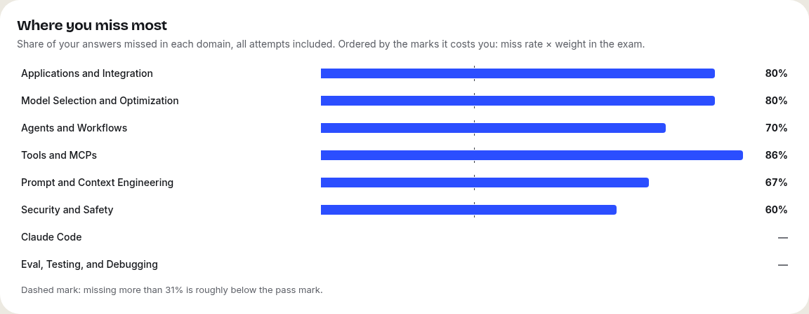
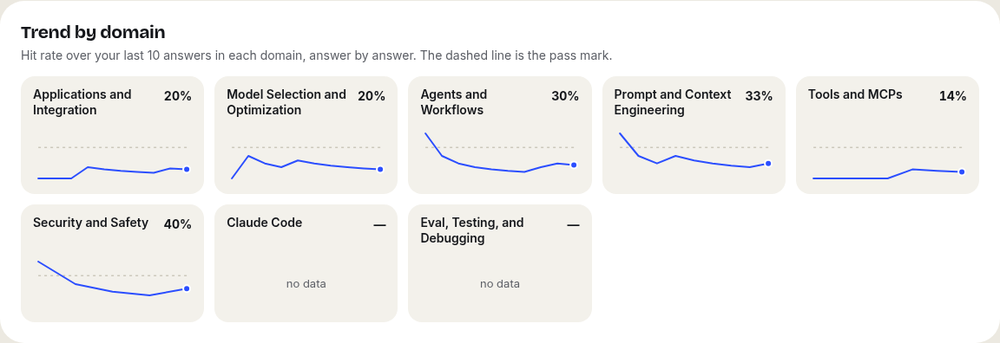

# CCDV-F Practice

**A free, open-source study app for the _Claude Certified Developer – Foundations_ (CCDV-F) exam.** Timed mock exams, domain drills, spaced-repetition flashcards, an AI tutor and charts of where you lose marks — in English and Spanish, synced across your devices.

**Try it:** https://exam.jarsss8.es · **Español:** [README.es.md](README.es.md)

> Independent community project. Not created, sponsored or endorsed by Anthropic. Passing a mock here does not guarantee passing the real exam.

<p>
  
  
</p>
<p>
  
  
</p>

## What it does

| | |
| --- | --- |
| **Mock exams** | Full 53-question / 120-minute mocks weighted like the real blueprint, a 15-question quick mock and the repo's three mocks. Always in English, like the real exam. |
| **Domain drills** | 10 questions from one domain with instant feedback and an explanation, favouring what you have not seen. |
| **Readiness estimate** | A 100–1000 range from your *first* attempts only, re-weighted by domain, with the 720 pass mark. |
| **Charts** | Where you miss most (by marks lost), trend per domain, most-missed questions, history of mocks. |
| **Flashcards** | FSRS spaced repetition; questions you miss join the deck automatically. |
| **AI tutor** *(optional)* | Ask why an option is wrong. It only talks about the question in front of you. |
| **AI questions** *(optional)* | Generates new items grounded in the notes, checked by a second model before they are kept. |
| **Two languages** | Interface, notes, flashcards, drills and tutor in English or Spanish. |
| **Your data** | Export everything as JSON or your answers as CSV; delete your account and all its data in one click. |
| **Works offline** | Progress is saved locally first and synced when you are back online. |

### Built to measure honestly

- **Options are shuffled on every attempt.** In the source bank the right answer follows fixed letter patterns and is often the longest option; without shuffling you pass by pattern.
- **Only first attempts count towards readiness.** Repeating a question measures memory, not readiness. Near-duplicate questions count once.
- **Exam simulations stay in English**, interface included, because the real exam is in English (or Japanese).

## How it works

```
Browser (React SPA, local-first)  ──HTTPS──▶  one Cloudflare Worker  ──▶  D1 (SQLite)
                                                  ├─ static assets (the SPA)
                                                  ├─ /api/auth/*  Better Auth (email + password, Google, GitHub)
                                                  ├─ /api/*       state, sync, AI tutor, question generation
                                                  └─ optional: DeepSeek API (AI), Cloudflare Email Service (password reset)
```

| Part | Technology |
| --- | --- |
| Frontend | React 19, Vite, TypeScript. No UI framework; one CSS file with design tokens (light and dark). |
| Backend | A single Cloudflare Worker with static assets. |
| Database | Cloudflare D1. Every row belongs to a user and is deleted with them. |
| Accounts | [Better Auth](https://www.better-auth.com) inside the Worker. Passwords hashed with PBKDF2-SHA256 (WebCrypto). |
| AI | [DeepSeek](https://platform.deepseek.com) API, optional, with per-user and global daily caps. |
| Email | Cloudflare Email Service, optional, only for password reset. |

The app is **local-first**: every action is applied to a local copy and queued; the queue is sent to `/api/sync`, validated on the server and written in one batch. The newest write wins across devices, and only the device holding an exam attempt can answer it.

## Run it locally

You need **Node.js 24+** and npm. No Cloudflare account is needed to run it locally.

```bash
git clone https://github.com/JarssS8/ccdvf-practice.git
cd ccdvf-practice
npm install

cp .dev.vars.example .dev.vars
# edit .dev.vars and set BETTER_AUTH_SECRET to a random value, e.g. the output of:
openssl rand -base64 32

npx wrangler d1 migrations apply ccdvf-practice --local
npm run build
npx wrangler dev --local-upstream localhost:8787
```

Open http://localhost:8787 and create an account. The local database lives in `.wrangler/`.

`--local-upstream` keeps the request host as `localhost`; without it Wrangler rewrites it to the production domain and sign-in fails the origin check. After changing frontend code, run `npm run build` again (Wrangler serves `dist/`).

## Deploy your own

1. **Cloudflare account and Wrangler login**
   ```bash
   npx wrangler login
   ```
2. **Create the database** and copy the `database_id` it prints:
   ```bash
   npx wrangler d1 create ccdvf-practice
   ```
3. **Edit `wrangler.jsonc`:**
   - `name`: your Worker's name.
   - `d1_databases[0].database_id`: the id from step 2.
   - **Domain:** with your own domain on Cloudflare, set `routes` to it. Without one, delete `routes` and set `"workers_dev": true`.
   - `vars.BETTER_AUTH_URL`: the public URL (`https://your.domain` or `https://<name>.<subdomain>.workers.dev`).
   - `vars.EMAIL_FROM`: a sender on your domain (only used for password reset).
4. **Set the auth secret:**
   ```bash
   openssl rand -base64 32 | npx wrangler secret put BETTER_AUTH_SECRET
   ```
5. **Create the tables and deploy:**
   ```bash
   npm run db:migrate
   npm run deploy
   ```
6. **Rewrite the legal pages** (`src/legal/info.ts`, `es.ts`, `en.ts`) with your own details before inviting anyone: they name the operator of the site.

### Optional features

| Feature | How to turn it on |
| --- | --- |
| **Google sign-in** | Google Cloud Console → *OAuth consent screen* (External, **Publish**) → *Credentials → OAuth client ID → Web application*. Authorised origin: your URL. Redirect URI: `https://<your-url>/api/auth/callback/google`. Then `npx wrangler secret put GOOGLE_CLIENT_ID` and `GOOGLE_CLIENT_SECRET`. |
| **GitHub sign-in** | github.com/settings/developers → *New OAuth App*. Callback URL: `https://<your-url>/api/auth/callback/github`. Then `npx wrangler secret put GITHUB_CLIENT_ID` and `GITHUB_CLIENT_SECRET`. |
| **AI tutor and AI questions** | Get an API key at platform.deepseek.com, then `npx wrangler secret put DEEPSEEK_API_KEY`. Tune `AI_USER_DAILY_LIMIT` and `AI_GLOBAL_DAILY_LIMIT`. Keep the account's prepaid balance low: it is your hard spending cap. |
| **Password reset by email** | Needs Workers Paid. Dashboard → **Compute → Email Service → Email Sending → Onboard Domain**, then set `ACCOUNT_RECOVERY` to `"on"` and deploy. |

Each sign-in provider appears on the sign-in screen only when both of its secrets exist; no redeploy needed.

### Configuration reference

| Name | Kind | Purpose |
| --- | --- | --- |
| `BETTER_AUTH_SECRET` | secret, **required** | Signs sessions and tokens. |
| `BETTER_AUTH_URL` | var, **required** | Public URL of the app (also the only trusted origin). |
| `GOOGLE_CLIENT_ID` / `GOOGLE_CLIENT_SECRET` | secrets | Google sign-in. |
| `GITHUB_CLIENT_ID` / `GITHUB_CLIENT_SECRET` | secrets | GitHub sign-in. |
| `DEEPSEEK_API_KEY` | secret | Enables the AI tutor and question generation. |
| `DEEPSEEK_MODEL` / `DEEPSEEK_CHECK_MODEL` | vars | Model for writing/tutoring and for the blind check. |
| `AI_USER_DAILY_LIMIT` / `AI_GLOBAL_DAILY_LIMIT` | vars | AI calls per user per day / for the whole app per day. |
| `EMAIL` | `send_email` binding | Cloudflare Email Service. |
| `EMAIL_FROM` | var | Sender address for password-reset emails. |
| `ACCOUNT_RECOVERY` | var | `"on"` shows "Forgot it?" (only after onboarding the sending domain). |

## Tests

```bash
npm test             # unit tests (Vitest): shuffling, scoring, chart data, CSV, i18n parity, translations, reset email
npm run test:e2e     # builds, starts the Worker on a throwaway local D1, runs API + headless-browser tests
npm run test:smoke   # checks a deployed instance with a self-deleting account (-- --base <url>, -- --ai)
```

Browser tests drive headless Chromium through `playwright-core`; set `CHROMIUM_PATH` if it is not at `/usr/bin/chromium` (they are skipped otherwise).

## Project structure

```
├─ worker/
│  ├─ index.ts        API: state, batched sync, AI tutor and generation, daily clean-up (cron)
│  ├─ auth.ts         Better Auth config: PBKDF2, rate limits, account linking, password reset
│  └─ email.ts        password-reset email (ES/EN)
├─ src/
│  ├─ views/          pages (Home, Exams, Exam, Results, Progress, Domains, Cards, Notes, Settings, Auth, Legal)
│  ├─ components/     question card, tutor, charts, shared UI
│  ├─ lib/            local-first store, attempt engine, flashcard scheduling, CSV export, auth client
│  ├─ i18n/           en.ts defines every UI string; es.ts must match it (checked by the tests)
│  ├─ legal/          legal notice, privacy, cookies, terms
│  ├─ content/        questions, flashcards, notes, news (+ es/ translations)
│  └─ shared/exam.ts  exam facts and option shuffling, shared with the Worker
├─ migrations/        D1 schema
├─ scripts/           content import, translation checks, local test runner
└─ tests/             unit/, e2e/, smoke.mjs
```

## Content and translations

The questions, flashcards, notes and news are imported from [Amey-Thakur/CLAUDE-CERTIFICATIONS](https://github.com/Amey-Thakur/CLAUDE-CERTIFICATIONS) with `npm run sync` (it expects this folder inside a clone of that repo; otherwise the committed content is used).

Spanish versions live in `src/content/es/`. Each entry stores `src`, a hash of the English text it was translated from; when the English changes, the app shows English for that item until the translation is updated. `npm run sync` reports stale translations; after fixing them run `node scripts/i18n.mjs stamp`.

To add a language: copy `src/i18n/es.ts`, translate it, register it in `src/i18n/index.ts`, and add `src/content/<lang>/` files.

## Security

- Each account can only read and write its own rows; the sync endpoint validates every operation and rejects outboxes written by another account on the same device.
- Passwords are PBKDF2-SHA256 with a random salt and **100,000 iterations**, the maximum the Workers runtime allows. That is below OWASP's current recommendation for PBKDF2 (600,000); rate limits on sign-in mitigate online guessing.
- Per-IP rate limits on sign-in, sign-up, password reset and account deletion; per-user and global AI caps.
- Strict Content-Security-Policy (no third-party scripts, styles or fonts), HSTS, `frame-ancestors 'none'`.
- No OAuth access tokens are stored. Signing in with Google/GitHub on an email that someone registered with an unverified password removes that password and its sessions; a password reset does the same.

Found a vulnerability? Please email the address in the app's legal notice instead of opening a public issue.

## Contributing

Issues and pull requests are welcome. Before opening a PR, run `npm run lint`, `npm test` and `npm run test:e2e`. If you change what data is stored or who receives it, update `src/legal/` in both languages.

## License and credits

- Code: [MIT](LICENSE) © 2026 JarssS8.
- Study content: MIT © 2026 Amey Thakur. Excerpts of the official exam guide are © Anthropic and quoted for educational purposes. See [NOTICE](NOTICE).
- Fonts: Inter and Bricolage Grotesque (SIL Open Font License), bundled via Fontsource.
